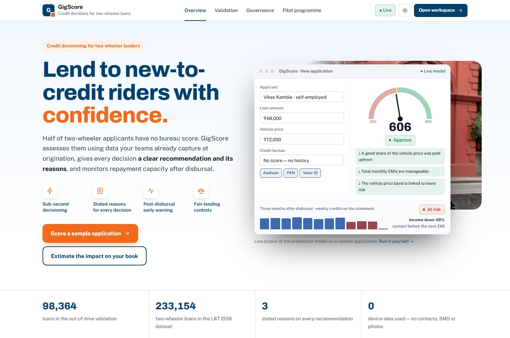
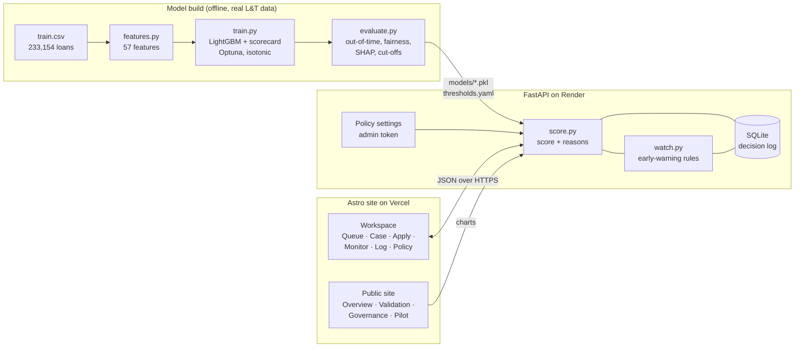
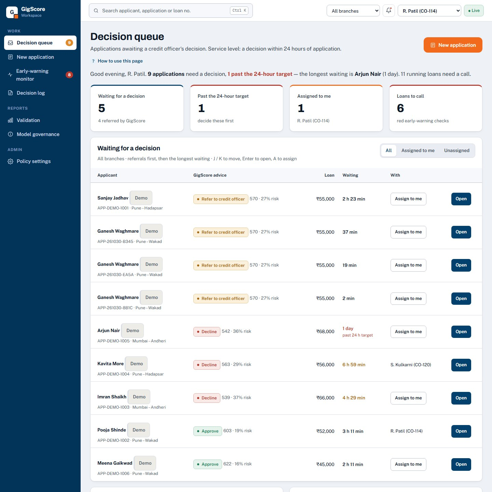
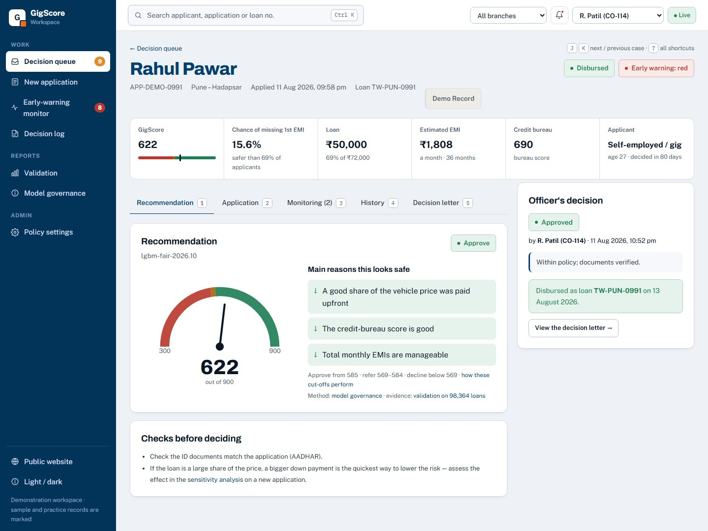
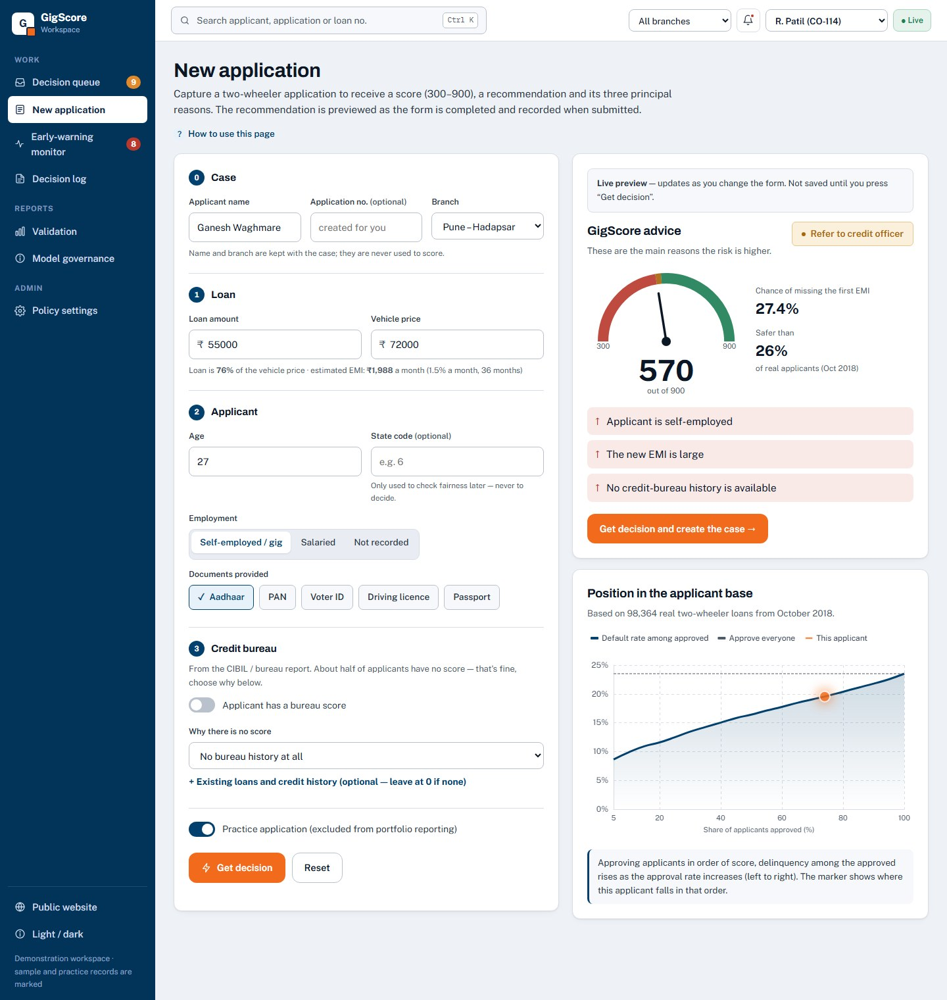
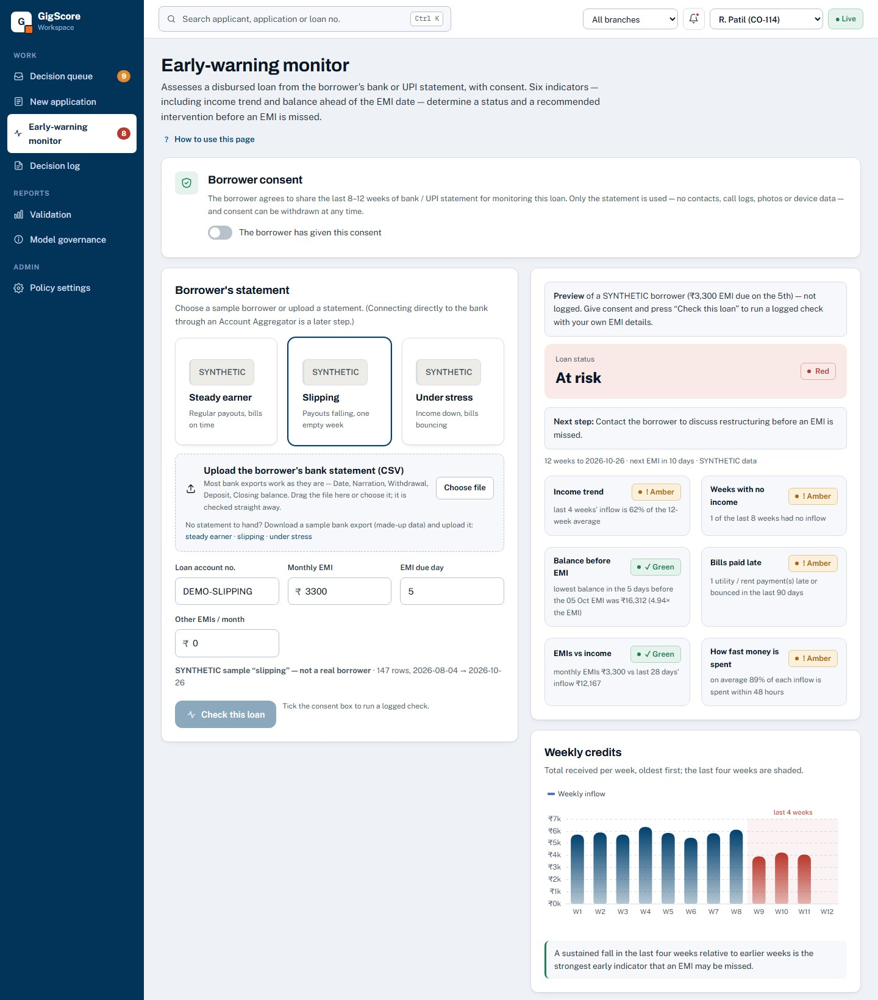
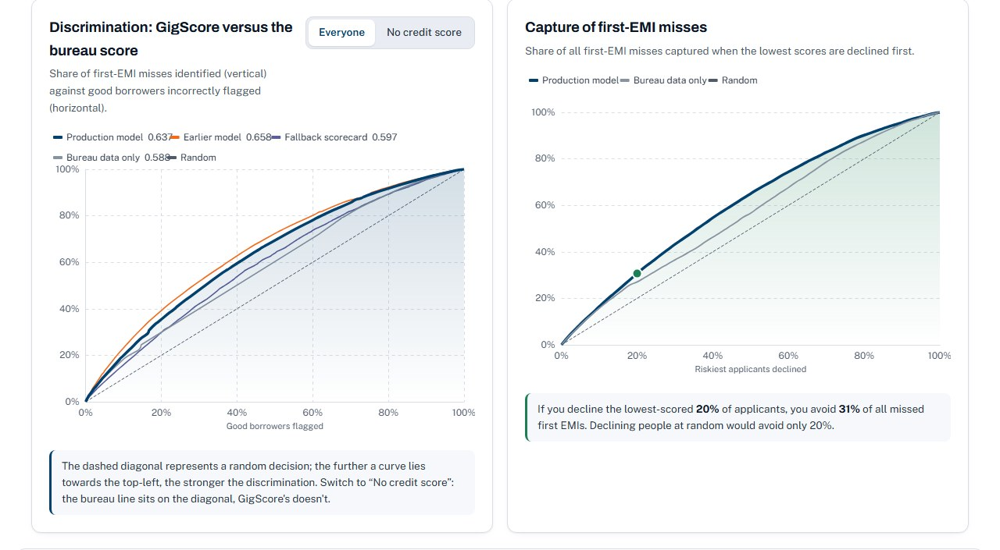
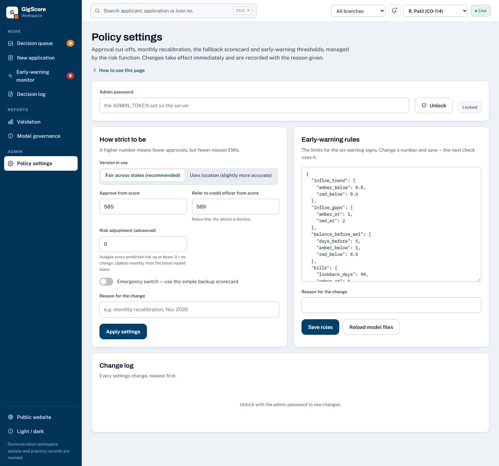

# GigScore — Credit Decisioning for Two-Wheeler Lenders


**Live demonstration:** [gigscoreindia.vercel.app](https://gigscoreindia.vercel.app) ·
**Credit-officer workspace:** [/app](https://gigscoreindia.vercel.app/app) ·
**API health:** [gigscore-api.onrender.com/health](https://gigscore-api.onrender.com/health)

In the L&T two-wheeler book, half of all applicants have no bureau score, and more than half are
self-employed — riders, drivers and other gig and informal workers. A bureau-only model cannot tell
these applicants apart, so lenders either decline them or price them blind. **GigScore** scores them using the data an NBFC already
captures at origination, gives every decision a clear recommendation and its reasons, and monitors
repayment capacity after disbursal so collections can act before an EMI is missed.

It is trained and validated on **233,154 real loans** from the L&T Vehicle Loan Default dataset, tested
out-of-time on a month the model never saw, and shipped with the governance a credit committee and a
regulator expect: calibrated probabilities, reason codes, a fairness review, an audit log and a kill
switch.



> The demonstration applicants, bank statements and officers are **synthetic**. The model and every
> validation number come from the real L&T data.

---

## 🚀 Key Features

### 🧠 Credit Model
- **Score in under a second:** one application in → a 300–900 score, the probability of missing the
  first EMI, and an Approve / Refer / Decline recommendation.
- **Built for no-score applicants:** for applicants without a bureau score, discrimination improves by
  **+0.104 AUC** over a bureau-only model.
- **Stated reasons for every decision:** TreeSHAP contributions turned into three plain-language reasons
  an officer can read out and a customer can be given.
- **Calibrated probabilities:** isotonic calibration plus a monthly recalibration offset, so the
  predicted default rate can be used for pricing and provisioning.
- **Fair by design:** area, branch, dealer and ID-document features were removed because they stood in
  for the applicant's state. That cut the largest state approval gap from **34.0 to 8.5 percentage
  points**.

### 🏦 Credit-Officer Workspace
- **Decision queue:** applications ordered by urgency against a 24-hour service level, with branch
  and officer filters, assignment, `Ctrl + K` search and keyboard shortcuts.
- **Case page:** score, risk, reasons, application details, monitoring and a full history. The officer
  records the final decision, and any override of the model needs a written reason.
- **Decision letters:** approval and decline letters with stated reasons, in English, Hindi and Marathi.
- **Live what-if:** while an application is being entered, the score updates as fields change, and a
  sensitivity view shows which change would move the decision.

### 📡 Early-Warning Monitor
- **Post-disbursal monitoring:** 8–12 weeks of bank or UPI statement data → green / amber / red, with
  the rules that fired: falling inflows, weeks with no income, low balance before the EMI date, late or
  bounced bills, high total EMI burden, and cash withdrawn within 48 hours of each inflow.
- **Real CSV uploads:** reads SBI- and HDFC-style statement exports. When the file has no category
  column, transactions are classified from their narration.
- **Collections call list:** red and amber borrowers ranked for a call before the next EMI date.

### 📊 Governance & Policy
- **Decision log:** every score, override and disbursal is stored with the model version, so any
  decision can be reconstructed for audit.
- **Policy settings without redeploying:** approve / refer cut-offs, recalibration offset, model
  choice, watch rules and a kill switch that routes every application to manual review.
- **Policy simulator:** move the cut-offs and see the approval rate and expected bad rate on October
  before applying the change.
- **Public validation and governance pages:** the evidence a lender's risk team asks for, in plain
  language.

---

## 📈 Validation Results

Trained on August–September 2018 (134,790 loans); tested **out-of-time on October 2018 (98,364 loans,
23.5% default rate)**. AUC with 95% bootstrap confidence intervals (500 resamples).

| Model | AUC — all applicants | AUC — no bureau score |
|:--|--:|--:|
| Bureau-only LightGBM (what lenders rely on today) | 0.588 (0.584–0.592) | 0.507 — no better than chance |
| **GigScore `lgbm_fair` (shipped)** | **0.637 (0.633–0.641)** | **0.611 (0.606–0.617)** |
| All-features LightGBM (not shipped: larger state gaps) | 0.658 (0.654–0.662) | 0.643 (0.638–0.649) |

| Business result (October, out-of-time) | Value |
|:--|--:|
| Extra loans approved at the bureau model's bad rate (bureau model approving 50%) | **+23,567** |
| No-score applicants approvable at ≤ 20.4% bad rate | **68.2%** (bureau-only: 0.1%) |
| Bad rate among approved — shipped cut-offs (approve ≥ 585, refer ≥ 569) | 17.5% vs 23.5% for approving everyone |
| Score stability (PSI, Oct / Nov) | 0.002 / 0.004 (< 0.1 is stable) |
| Largest state approval gap — all features → shipped model | 34.0 pp → 8.5 pp |

Full detail: [`reports/validation_report.md`](reports/validation_report.md) ·
[`reports/model_card.md`](reports/model_card.md).

---

## 🛠️ Tech Stack

| Layer | Technology |
|:--|:--|
| **Frontend** | Astro 5, TypeScript, Apache ECharts, view transitions, light and dark themes |
| **Typography** | Archivo (headlines), Public Sans (body), IBM Plex Mono (figures) |
| **Backend** | FastAPI, Uvicorn, Pydantic, Python 3.12 |
| **Machine learning** | LightGBM, scikit-learn (WoE scorecard, isotonic calibration), Optuna |
| **Explainability & fairness** | SHAP (TreeSHAP), subgroup approval and error-rate analysis, proxy detection |
| **Data** | pandas, NumPy, PyArrow, category_encoders |
| **Storage** | SQLite audit log (decisions, officer actions, policy changes) |
| **Testing** | pytest — 48 tests on synthetic fixtures and the trained models |
| **Deployment** | Vercel (website) · Render (API) · GitHub |

---

## 🏗️ System Architecture



**Decision flow:** application → score and reasons → officer reviews the case → final decision
(override needs a reason) → decision letter → disbursal → statement monitoring → collections call list.

---

## 🖥️ Screenshots

| Decision queue | Case page |
|:--:|:--:|
|  |  |
| **New application with live score** | **Early-warning monitor** |
|  |  |
| **Validation** | **Policy settings** |
|  |  |

---

## 🔌 API

Interactive documentation at `/docs` on the API. Main endpoints:

| Method | Endpoint | Purpose |
|:--|:--|:--|
| `POST` | `/score` | Score an application and log the decision |
| `POST` | `/score/preview` | Score without logging (live what-if) |
| `POST` | `/watch` | Assess a bank / UPI statement → green / amber / red |
| `GET` | `/inbox` | Applications awaiting a decision |
| `GET` | `/cases/{application_id}` | Full case: score, reasons, actions, history |
| `POST` | `/decisions/{id}/final` | Officer's final decision (override requires a reason) |
| `POST` | `/decisions/{id}/assign` · `/disburse` · `/followup` | Workflow actions |
| `GET` | `/collections/queue` | Borrowers to call, red first |
| `GET` | `/portfolio/summary` | Decision-log totals, overrides, officer activity |
| `GET` | `/model/analytics` | Data behind the validation charts |
| `PUT` | `/admin/thresholds` · `/admin/watch-rules` | Change policy (admin token required) |

---

## 📁 Project Structure

```
api/          FastAPI application
src/          load, features, encode, train, evaluate, explain, fairness,
              score, watch, decision_log, analytics, demo_seed
frontend/     Astro website and /app workspace
config/       thresholds.yaml (cut-offs, offset, model, kill switch), watch_rules.yaml
models/       trained models, encoders, reference data for the app
reports/      profile, features, model results, validation report, model card, figures
docs/         build guide, explainer PDF, screenshots
tests/        pytest suite
render.yaml   Render blueprint for the API
```

---

## ⚙️ Run Locally (Windows PowerShell)

```powershell
python -m venv .venv
.\.venv\Scripts\python.exe -m pip install -r requirements.txt
cd frontend; npm install; npm run build; cd ..
.\.venv\Scripts\python.exe -m src.demo_seed          # synthetic demonstration cases
.\.venv\Scripts\uvicorn.exe api.main:app --reload
```

Open http://localhost:8000 for the website and http://localhost:8000/docs for the API.
For live front-end editing run `npm run dev` in `frontend/` (http://localhost:4321).
To unlock Policy settings, set `$env:ADMIN_TOKEN = "<a long random string>"` before starting the API.
`python -m src.demo_seed --reset` restores the demonstration data (the old log is backed up first).

### Rebuild the model from the raw data

Download `train.csv` and `test.csv` from Kaggle (`mamtadhaker/lt-vehicle-loan-default-prediction`)
into `data/raw/`, then:

```powershell
.\.venv\Scripts\python.exe -m src.profiling   # reports/profile.md
.\.venv\Scripts\python.exe -m src.features    # data/processed/*, models/encoders.pkl
.\.venv\Scripts\python.exe -m src.train       # models/*.pkl (about 45 minutes)
.\.venv\Scripts\python.exe -m src.evaluate    # reports, config/thresholds.yaml
.\.venv\Scripts\python.exe -m src.analytics   # models/analytics.json
.\.venv\Scripts\python.exe -m pytest -q
```

A running API picks up retrained files from Policy settings → *Reload model files*.

---

## ☁️ Deployment

Both services redeploy automatically on every push to `main`.

| Service | Platform | Configuration |
|:--|:--|:--|
| API | Render (Blueprint from `render.yaml`) | `ADMIN_TOKEN` — private admin password · `ALLOWED_ORIGINS` — `https://gigscoreindia.vercel.app` |
| Website | Vercel (root directory `frontend`) | `PUBLIC_API_URL` — `https://gigscore-api.onrender.com` |

The demonstration runs on Render's free plan: the service sleeps after about 15 minutes idle (the
first request then takes about 50 seconds), and the decision log resets on restart. For a pilot, move
to the starter plan with a persistent disk — see the comments in `render.yaml`.

---

## ⚠️ Limitations

- The data is from one lender in 2018; default levels and ticket sizes are dated. A lender should
  retrain and re-validate on its own book before use.
- October's default rate (23.5%) was above the training window's (20.4%), so raw predictions run low
  until the monthly recalibration offset is applied.
- The model uses the day of the month the loan is disbursed, so the same application can score
  slightly differently on different days.
- Hindi and Marathi decision letters need review by a native speaker before customer use.
- Statement monitoring uses rules, not a trained model. Its thresholds should be tuned on the lender's
  own collections outcomes.
