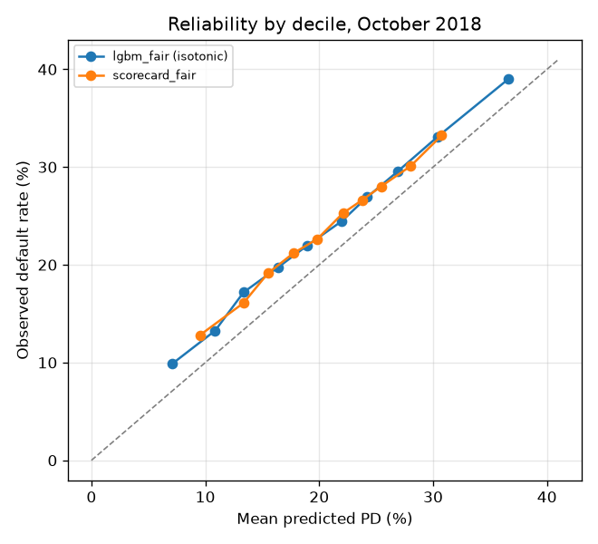
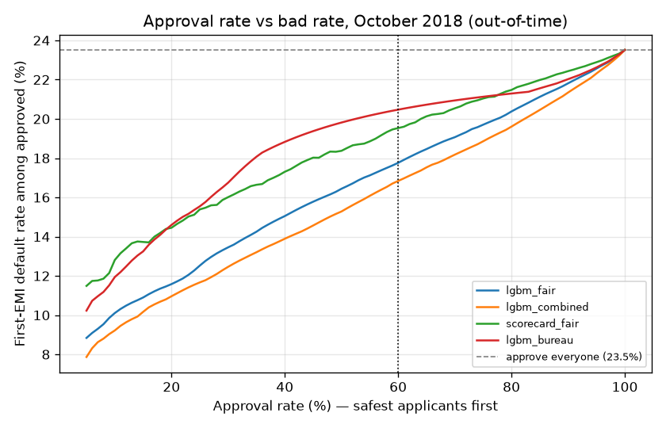
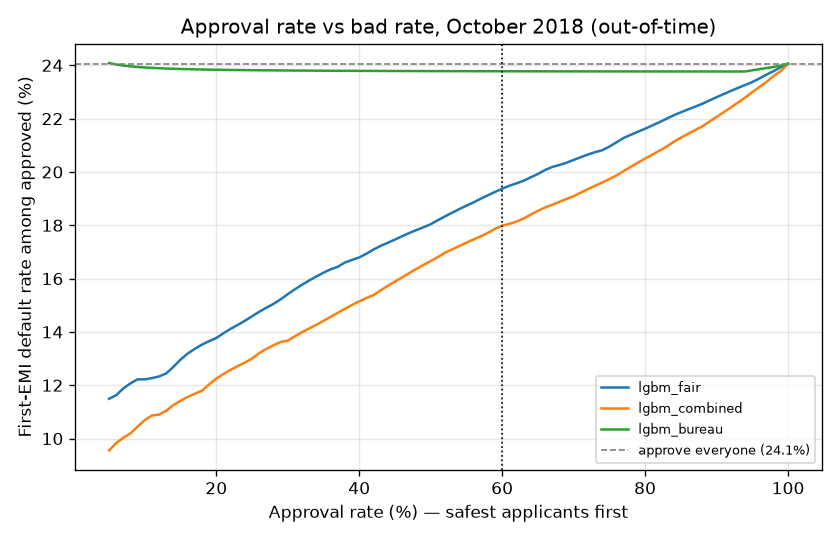
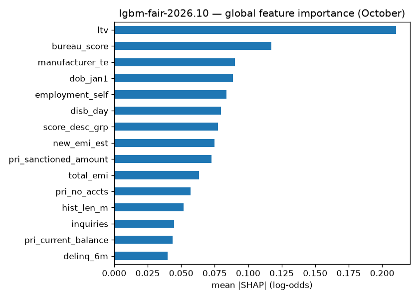
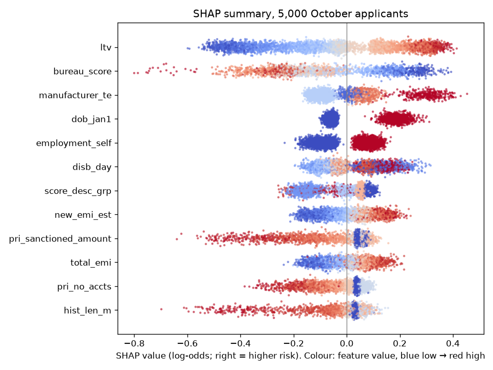
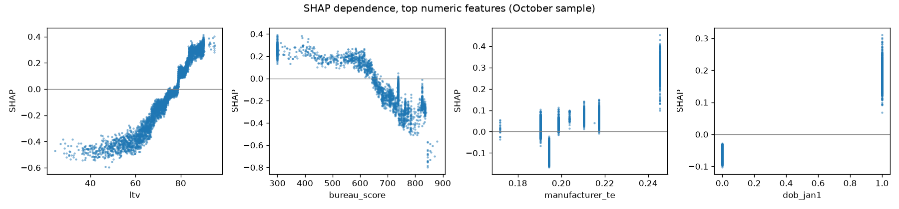

# Validation report — GigScore

Produced by `src/evaluate.py` (`python -m src.evaluate --boot 500`), which calls `src/explain.py` and `src/fairness.py`, on 2026-10-29. Real L&T data. Models from `src/train.py` (see `reports/model_results.md`). Test set: **October 2018, out-of-time** (98,364 loans, default rate 23.5%); models were trained on Aug–Sep 2018.

## 1. Tests run

| test | how | result |
|:--|:--|:--|
| Discrimination | AUC, Gini, KS; 500 paired bootstrap resamples | Section 2 |
| Random vs out-of-time split | same LightGBM settings refit on a random 80/20 split of all months | Section 2 |
| Calibration | reliability by decile, Brier score, before / after isotonic | Section 3 |
| Stability | PSI of the score (Oct, Nov vs Aug–Sep) and of every feature | Section 4 |
| Business | approval-rate vs bad-rate curve; extra approvals at equal bad rate | Section 5 |
| Cut-offs | approve safest 60%, refer next 20% of Aug–Sep; applied to October → `config/thresholds.yaml` | Section 6 |
| Recalibration | monthly log-odds offset fitted on 1–15 Oct, tested on 16–31 Oct | Section 3 |
| Explainability | TreeSHAP (LightGBM `pred_contrib`), reason codes for every applicant | Section 7 |
| Fairness | approval and error rates by age band and state; proxy check; mitigation test | Section 8 |

## 2. Discrimination (October, out-of-time)

| model | all | no score | no usable score | self-employed |
|:--|--:|--:|--:|--:|
| scorecard_bureau | 0.555 (0.551–0.559) | 0.499 (0.498–0.500) | 0.503 (0.500–0.506) | 0.550 (0.545–0.555) |
| lgbm_bureau | 0.588 (0.584–0.592) | 0.507 (0.505–0.510) | 0.519 (0.515–0.522) | 0.583 (0.578–0.588) |
| scorecard_alternative | 0.617 (0.612–0.621) | 0.625 (0.620–0.630) | 0.624 (0.618–0.629) | 0.616 (0.611–0.622) |
| lgbm_alternative | 0.631 (0.627–0.635) | 0.640 (0.635–0.645) | 0.638 (0.633–0.642) | 0.629 (0.624–0.635) |
| scorecard_combined | 0.629 (0.625–0.633) | 0.625 (0.620–0.630) | 0.624 (0.618–0.629) | 0.627 (0.621–0.632) |
| lgbm_combined | 0.658 (0.654–0.662) | 0.643 (0.638–0.649) | 0.643 (0.638–0.648) | 0.655 (0.649–0.660) |
| scorecard_fair | 0.597 (0.593–0.601) | 0.580 (0.574–0.585) | 0.580 (0.575–0.586) | 0.590 (0.585–0.596) |
| lgbm_fair | 0.637 (0.633–0.641) | 0.611 (0.606–0.617) | 0.612 (0.607–0.617) | 0.631 (0.626–0.636) |

AUC with 95% CI. **No-score subgroup: lgbm_fair vs lgbm_bureau +0.104 (+0.098 to +0.110).** Gini and KS for every model and subgroup are in `reports/model_results.md`.

| model | random-split AUC | out-of-time AUC |
|:--|--:|--:|
| lgbm_bureau | 0.595 | 0.588 |
| lgbm_combined | 0.672 | 0.658 |
| lgbm_fair | 0.646 | 0.637 |

The random split mixes October into training, so it flatters the model; the out-of-time number is the one to quote.

## 3. Calibration

Brier score on October (lower is better): lgbm_fair raw 0.2214; lgbm_fair isotonic 0.1732; scorecard_fair 0.1770; lgbm_combined isotonic 0.1708; constant (Aug–Sep default rate) 0.1808.

**lgbm_fair (isotonic)** — 10 of 10 deciles outside ±2 pp

| decile | mean predicted | observed | diff (pp) |
|--:|--:|--:|--:|
| 1 | 7.1% | 9.9% | -2.8 |
| 2 | 10.9% | 13.3% | -2.4 |
| 3 | 13.4% | 17.2% | -3.8 |
| 4 | 16.4% | 19.8% | -3.3 |
| 5 | 18.9% | 21.9% | -3.0 |
| 6 | 22.0% | 24.5% | -2.5 |
| 7 | 24.2% | 26.9% | -2.7 |
| 8 | 26.9% | 29.6% | -2.7 |
| 9 | 30.4% | 33.1% | -2.7 |
| 10 | 36.6% | 39.0% | -2.4 |

**lgbm_fair (raw, before isotonic)** — 10 of 10 deciles outside ±2 pp

| decile | mean predicted | observed | diff (pp) |
|--:|--:|--:|--:|
| 1 | 19.2% | 9.9% | +9.3 |
| 2 | 29.1% | 13.3% | +15.8 |
| 3 | 35.1% | 17.3% | +17.9 |
| 4 | 40.3% | 19.7% | +20.5 |
| 5 | 44.6% | 22.2% | +22.4 |
| 6 | 48.5% | 24.4% | +24.1 |
| 7 | 52.0% | 26.8% | +25.2 |
| 8 | 55.5% | 29.6% | +25.9 |
| 9 | 59.4% | 33.0% | +26.4 |
| 10 | 66.0% | 39.1% | +26.9 |

**scorecard_fair** — 10 of 10 deciles outside ±2 pp

| decile | mean predicted | observed | diff (pp) |
|--:|--:|--:|--:|
| 1 | 9.5% | 12.8% | -3.3 |
| 2 | 13.4% | 16.1% | -2.7 |
| 3 | 15.5% | 19.1% | -3.6 |
| 4 | 17.7% | 21.2% | -3.5 |
| 5 | 19.8% | 22.6% | -2.8 |
| 6 | 22.1% | 25.3% | -3.2 |
| 7 | 23.8% | 26.6% | -2.9 |
| 8 | 25.4% | 28.0% | -2.6 |
| 9 | 28.0% | 30.1% | -2.1 |
| 10 | 30.7% | 33.2% | -2.5 |

On Aug–Sep out-of-fold predictions (where isotonic was fitted) 0 of 10 deciles are outside ±2 pp. On October the model under-predicts because October's default rate (23.5%) is above the training window's (20.4%); no model trained on Aug–Sep can know that in advance. Hindsight offset for the whole of October: +0.174 log-odds.

**Monthly recalibration (the deployment procedure, backtested).** First-EMI outcomes mature about a month after disbursal, so by mid-November a lender knows them for loans disbursed 1–15 October (26,313 loans). Fitting the log-odds offset on those (+0.027) and applying it to loans disbursed 16–31 October (72,051):

| 16–31 Oct | mean predicted PD | observed | deciles outside ±2 pp | worst decile gap |
|:--|--:|--:|--:|--:|
| as trained | 20.5% | 24.3% | 10 of 10 | 4.6 pp |
| with offset | 21.0% | 24.3% | 10 of 10 | 4.0 pp |

Ranking is unchanged by the offset (AUC identical: True). The offset lives in `config/thresholds.yaml` (`calibration_offset`, 0 as shipped) so a lender updates it without code changes. Score cut-offs are on the score, which also moves with the offset; re-check band shares after updating it.

## 4. Stability

Score PSI (reference: Aug–Sep out-of-fold scores): lgbm_fair: Oct 0.002, Nov 0.004; scorecard_fair: Oct 0.007, Nov 0.016; lgbm_combined: Oct 0.000, Nov 0.003; scorecard_combined: Oct 0.002, Nov 0.004 (< 0.1 stable, > 0.25 investigate). November = test.csv (112,392 unlabelled loans).

Model features with PSI above 0.1 (from `data/processed/feature_stats.csv`, step 2):

| feature | PSI Oct | PSI Nov |
|:--|--:|--:|
| `asset_cost_log` | 0.278 | 0.193 |
| `kyc_count` | 0.001 | 0.103 |
| `has_pan` | 0.001 | 0.116 |
| `disb_weekday` | 0.105 | 0.013 |
| `disb_day` | 0.195 | 0.544 |

## 5. Business view

Bad rate among approved applicants when approving the safest share (October):

| approval rate | lgbm_fair (shipped) | lgbm_combined | scorecard_fair | lgbm_bureau |
|--:|--:|--:|--:|--:|
| 50.0% | 16.4% | 15.3% | 18.4% | 19.8% |
| 60.0% | 17.8% | 16.8% | 19.5% | 20.5% |
| 70.0% | 19.1% | 18.2% | 20.5% | 20.9% |
| 80.0% | 20.4% | 19.6% | 21.5% | 21.3% |
| 90.0% | 21.8% | 21.3% | 22.4% | 22.0% |

Approving everyone gives 23.5%.

Extra approvals (of 98,364) at the same bad rate as the bureau-only model:

| bureau-only approves | its bad rate | lgbm_fair approves | extra | lgbm_combined approves | extra |
|--:|--:|--:|--:|--:|--:|
| 50.0% | 19.8% | 74.0% | +23,567 | 79.3% | +28,778 |
| 60.0% | 20.5% | 80.0% | +19,703 | 84.9% | +24,488 |
| 70.0% | 20.9% | 82.7% | +12,463 | 86.0% | +15,770 |

**No-score applicants:** holding the bad rate at or below the training window's 20.4%, lgbm_fair can approve 68.2% of them, lgbm_combined 76.0%, the bureau-only model 0.1%.

## 6. Proposed cut-offs (`config/thresholds.yaml`)

Policy: approve the safest 60%, refer the next 20%, decline the rest. Cut-offs are chosen on Aug–Sep out-of-fold scores and then applied unchanged to October, so the October band rates below are a genuine out-of-time result (the guide's suggestion of choosing them on the test set would make them optimistic). The lender should pick its own point on the curve. Score scale: 600 points at 4:1 good:bad odds (PD 20%), 50 points to double the odds.

- **lgbm_fair**: approve if score ≥ 585, refer if ≥ 569, else decline.
- **scorecard_fair**: approve if score ≥ 589, refer if ≥ 573, else decline.
- **lgbm_combined**: approve if score ≥ 589, refer if ≥ 569, else decline.
- **scorecard_combined**: approve if score ≥ 593, refer if ≥ 571, else decline.

**all** (October)

| band | loans | share | default rate |
|:--|--:|--:|--:|
| approve | 56,923 | 57.9% | 17.5% |
| refer | 21,680 | 22.0% | 27.9% |
| decline | 19,761 | 20.1% | 36.1% |

**no_score** (October)

| band | loans | share | default rate |
|:--|--:|--:|--:|
| approve | 23,703 | 47.6% | 17.8% |
| refer | 14,320 | 28.8% | 26.8% |
| decline | 11,725 | 23.6% | 33.4% |

**self_employed** (October)

| band | loans | share | default rate |
|:--|--:|--:|--:|
| approve | 28,778 | 52.9% | 17.9% |
| refer | 12,561 | 23.1% | 27.8% |
| decline | 13,034 | 24.0% | 36.1% |

**fallback (scorecard)** (October)

| band | loans | share | default rate |
|:--|--:|--:|--:|
| approve | 57,119 | 58.1% | 19.3% |
| refer | 21,988 | 22.4% | 27.3% |
| decline | 19,257 | 19.6% | 31.7% |

**alternative (lgbm_combined)** (October)

| band | loans | share | default rate |
|:--|--:|--:|--:|
| approve | 59,726 | 60.7% | 16.9% |
| refer | 18,233 | 18.5% | 27.8% |
| decline | 20,405 | 20.7% | 39.0% |

Main-model bands on Aug–Sep out-of-fold scores, where the cut-offs were chosen:

| band | loans | share | default rate |
|:--|--:|--:|--:|
| approve | 79,590 | 59.0% | 14.3% |
| refer | 28,942 | 21.5% | 25.4% |
| decline | 26,258 | 19.5% | 33.2% |

## 7. Explainability

TreeSHAP from LightGBM (`pred_contrib`) for all 98,364 October applicants; additivity check (max |sum of SHAP − model log-odds|) = 8.2e-15.

Top features by mean |SHAP|: `ltv` 0.210, `bureau_score` 0.117, `manufacturer_te` 0.090, `dob_jan1` 0.089, `employment_self` 0.084, `disb_day` 0.080, `score_desc_grp` 0.078, `new_emi_est` 0.075, `pri_sanctioned_amount` 0.073, `total_emi` 0.063.

**Reason codes.** 100.0% of applicants get three distinct reasons (100.0% get at least one). Process features (disb_day, disb_weekday, dob_jan1) are never shown as reasons; they carry 12.9% of total |SHAP|. Every model feature has a reason text (`src/explain.py`).

Most frequent reasons by band (share of applicants in the band who get the reason):

*approve*: A good share of the vehicle price was paid upfront (55%); The credit-bureau score is good (34%); This vehicle make has a better repayment history (30%); Applicant is not self-employed (26%); Credit-bureau risk grade is low (A–D) (25%); Total monthly EMIs are manageable (23%)

*refer*: The loan is a high share of the vehicle price (53%); The new EMI is large (53%); The credit-bureau score is low (45%); Applicant is self-employed (34%); This vehicle make has a weaker repayment history (25%); Total monthly EMIs, including this loan, are high (24%)

*decline*: The loan is a high share of the vehicle price (69%); The credit-bureau score is low (49%); The new EMI is large (46%); This vehicle make has a weaker repayment history (28%); Applicant is self-employed (22%); Total monthly EMIs, including this loan, are high (18%)

Examples (first October applicant in each band):

- approve: The bureau has too little information to score · Applicant is not self-employed · No rush of new loans recently
- refer: The loan is a high share of the vehicle price · The new EMI is large · The credit-bureau score is low
- decline: The loan is a high share of the vehicle price · The credit-bureau score is low · Credit-bureau risk grade is high (I–M)

## 8. Fairness

Protected attributes (age band, state) are **not** model inputs. Results below use lgbm-fair-2026.10 with the proposed cut-offs (approve ≥ 585, refer ≥ 569) on October. TPR = share of defaulters not approved; FPR = share of non-defaulters not approved (good applicants turned away). Gaps are vs all applicants; flagged when approval or FPR gap exceeds 5 pp. Groups with fewer than 500 October loans are not shown.

### By age band

| group | loans | default rate | approval | gap | FPR | FPR gap | TPR | AUC | flag |
|:--|--:|--:|--:|--:|--:|--:|--:|--:|:--|
| 18-24 | 18,706 | 25.6% | 55.5% | -2.4 pp | 40.2% | +2.6 pp | 56.9% | 0.616 |  |
| 25-34 | 37,292 | 24.2% | 58.8% | +0.9 pp | 36.6% | -1.0 pp | 55.6% | 0.633 |  |
| 35-44 | 25,465 | 22.1% | 57.5% | -0.4 pp | 38.0% | +0.4 pp | 58.4% | 0.643 |  |
| 45-54 | 13,634 | 22.0% | 58.5% | +0.7 pp | 36.6% | -1.0 pp | 58.7% | 0.656 |  |
| 55+ | 3,267 | 20.1% | 61.3% | +3.4 pp | 34.3% | -3.2 pp | 56.0% | 0.654 |  |

0 of 5 age band groups flagged. Correlation between a group's actual default rate and its approval rate: -0.83 (strongly negative = gaps follow real risk differences rather than arbitrary ones).

### By state

| group | loans | default rate | approval | gap | FPR | FPR gap | TPR | AUC | flag |
|:--|--:|--:|--:|--:|--:|--:|--:|--:|:--|
| 1 | 3,423 | 20.2% | 61.9% | +4.0 pp | 34.0% | -3.6 pp | 54.5% | 0.648 |  |
| 2 | 1,760 | 31.8% | 52.1% | -5.8 pp | 43.7% | +6.1 pp | 56.9% | 0.609 | **yes** |
| 3 | 17,757 | 19.7% | 59.4% | +1.5 pp | 37.1% | -0.5 pp | 55.0% | 0.623 |  |
| 4 | 18,996 | 22.8% | 57.1% | -0.8 pp | 38.4% | +0.8 pp | 58.1% | 0.639 |  |
| 5 | 4,599 | 21.7% | 59.7% | +1.8 pp | 35.7% | -1.9 pp | 57.0% | 0.653 |  |
| 6 | 14,383 | 22.1% | 62.6% | +4.8 pp | 32.8% | -4.7 pp | 53.4% | 0.649 |  |
| 7 | 2,436 | 23.3% | 55.0% | -2.9 pp | 41.0% | +3.4 pp | 58.3% | 0.628 |  |
| 8 | 5,382 | 26.6% | 55.8% | -2.1 pp | 38.3% | +0.8 pp | 60.4% | 0.651 |  |
| 9 | 5,930 | 24.8% | 55.8% | -2.1 pp | 39.0% | +1.4 pp | 60.0% | 0.646 |  |
| 10 | 1,315 | 19.2% | 58.7% | +0.8 pp | 38.1% | +0.5 pp | 54.8% | 0.617 |  |
| 11 | 2,590 | 20.4% | 52.7% | -5.2 pp | 43.1% | +5.5 pp | 63.9% | 0.648 | **yes** |
| 12 | 1,625 | 35.1% | 61.5% | +3.7 pp | 35.4% | -2.2 pp | 44.2% | 0.554 |  |
| 13 | 6,836 | 32.0% | 52.9% | -5.0 pp | 41.4% | +3.8 pp | 59.2% | 0.623 |  |
| 14 | 3,440 | 29.0% | 48.5% | -9.4 pp | 46.1% | +8.5 pp | 64.9% | 0.628 | **yes** |
| 15 | 2,379 | 24.1% | 59.2% | +1.4 pp | 35.1% | -2.4 pp | 58.5% | 0.657 |  |
| 16 | 1,150 | 21.0% | 59.6% | +1.7 pp | 36.8% | -0.8 pp | 54.1% | 0.629 |  |
| 17 | 1,843 | 24.8% | 60.7% | +2.8 pp | 35.2% | -2.4 pp | 51.6% | 0.618 |  |
| 18 | 1,936 | 24.0% | 58.5% | +0.6 pp | 38.2% | +0.6 pp | 52.2% | 0.616 |  |

3 of 18 state groups flagged. Correlation between a group's actual default rate and its approval rate: -0.37 (strongly negative = gaps follow real risk differences rather than arbitrary ones).

### Proxy check

Features most associated with age (|Spearman|): `hist_len_m` 0.27, `acct_age_m` 0.27, `pri_no_accts` 0.24, `employment_unknown` 0.23, `no_score` 0.21, `pri_sanctioned_amount` 0.21.

Features most associated with state (correlation ratio η): `branch_te` 0.73, `has_aadhar` 0.59, `has_voterid` 0.55, `supplier_n` 0.52, `branch_n` 0.48, `supplier_te` 0.44.

### Mitigation options: retrain without the features that stand in for state

Indented rows refit the all-features LightGBM on all of Aug–Sep with its parameters and tree count, dropping more proxy features each time; the last row is the shipped model, tuned on its own. Each approves the safest 60% of October. State gaps are vs all applicants. The proxy check above is on the all-features model, which is why the shipped model leaves those features out.

| option | AUC | AUC no-score | bad rate approved | largest state approval gap | largest state FPR gap | states flagged |
|:--|--:|--:|--:|--:|--:|--:|
| lgbm-combined-2026.10 (all features) | 0.658 | 0.643 | 16.8% | 34.0 pp | 34.6 pp | 9 of 18 |
|   without area & branch | 0.652 | 0.636 | 17.1% | 28.9 pp | 28.9 pp | 10 of 18 |
|   without area, branch & dealer | 0.639 | 0.615 | 17.7% | 20.1 pp | 18.7 pp | 7 of 18 |
|   without area, branch, dealer & ID documents | 0.636 | 0.611 | 17.8% | 8.6 pp | 7.8 pp | 3 of 18 |
| **lgbm-fair-2026.10 (shipped; own tuning)** | 0.637 | 0.611 | 17.8% | 8.5 pp | 7.7 pp | 3 of 18 |

Shipped choice: the model without area, branch, dealer and ID-document features, trading some accuracy for far smaller state gaps (rationale in `reports/model_card.md`). A lender can switch `model` in `config/thresholds.yaml` to the all-features model.

## 9. Sign-off

To be completed by an independent validator; this report is generated, not signed.

| role | name | date | decision |
|:--|:--|:--|:--|
| Model owner | | | |
| Independent validator | | | |
| Risk committee | | | |
